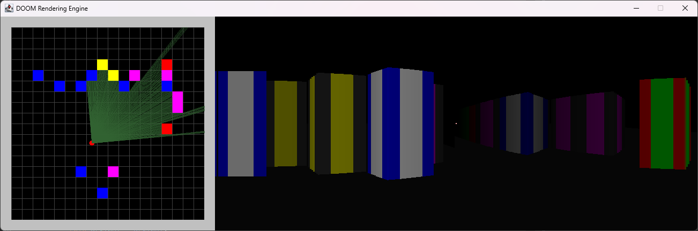

# DOOM Rendering Engine

A small pseudo-3D rendering engine inspired by DOOM, written in plain Java with Swing.
I built it back in my university days and recently recovered it.

The window is split in two: on the left is a top-down editor of the level, and on the right is the
first-person view, drawn live from that map. There are no game engine or graphics libraries involved,
only `java.awt.Graphics` drawing rectangles.



## How it works

The renderer uses **ray casting**, the technique behind the classic early-90s first-person shooters.

- The level is a 20 × 20 grid. Each cell is empty or holds one of seven block types.
- Each frame, 300 rays fan out from the player, 0.4° apart, for a 120° field of view.
- Each ray steps across the grid one line at a time, testing horizontal and vertical grid lines
  separately, and stops at the first wall it hits. The rays are drawn in green on the map so you can
  watch them.
- The distance to the hit decides how tall that screen column is drawn. Nearer walls are taller.
- Walls fade towards black with distance, up to a render distance of 10 cells.
- Each block face has a simple four-stripe texture, picked by where along the wall the ray landed.
- Wall edges and corners are outlined. The engine spots a sudden change in the distances of
  neighbouring rays, then darkens inner corners and brightens outer ones.
- Movement checks for collisions on each axis separately, so the player slides along walls instead of
  sticking to them.

## Controls

Hold the keys to move and turn smoothly. You can combine them, for example to walk and turn at the
same time.

| Input | Action |
| --- | --- |
| `W` `A` `S` `D` | Move forward, left, back, right |
| `↑` / `↓` | Move forward / back |
| `J` `L` or `←` `→` | Turn left / right |
| Drag in the 3D view | Turn |
| `N` / `M` | Narrow / widen the field of view |
| Left click on the map | Place a block, or cycle the cell through the block types |
| Right click on the map | Remove a block |
| Middle click on the map | Teleport the player to that cell |

## Running it

You need Java 17 or newer. There are no dependencies.

**Eclipse:** File → Import → General → Existing Projects into Workspace, select this folder, then run
`Main.java` as a Java Application.

**IntelliJ IDEA:** open the folder and run `Main`.

**Command line:**

```bash
javac -d bin src/*.java
java -cp bin Main
```

## Project layout

- `src/Main.java`: creates the window.
- `src/RenderPanel.java`: the map, the ray caster, the renderer and the input handling.

## Notes

This is a university project kept largely as it was written. Wall heights come from the raw ray
distance, without fisheye correction, so walls bow slightly towards the edges of a wide field of view.
